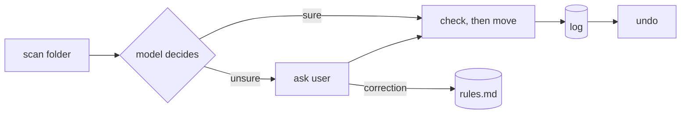

# file-manager — Design Document

> Sorts the loose files in a folder into a numbered `NN_Category` folder tree. An AI model decides where each file goes; plain code does the moving. Works as a Claude Code plugin or with any other model.

## 1. What it does

- Sorts the top level of one folder (default: the current folder, so `cd` into a folder and run `organize`) into the user's `NN_` tree.
- Decides from the filename first and reads the content only when the name isn't enough.
- Moves files it is sure about. Asks about the rest.
- Renames files to `YYYY-MM-DD_description.ext`.
- Sends installers (`.dmg`, `.pkg`) to the Trash. Never deletes permanently.
- Remembers corrections in `rules.md`, and can undo any run.

Not in v1: scheduled runs, sorting inside subfolders, duplicate cleanup, Linux or Windows.

## 2. How it's built



| Part                 | Job                                                                |
| -------------------- | ------------------------------------------------------------------ |
| Core (Python, no AI) | Scan, safety checks, move, Trash, log, undo                        |
| Claude Code plugin   | `/file-manager:organize [path]`. Uses the Claude plan; no API key. |
| Standalone command   | `organize [path]`. Uses the user's own API key or a local model.   |

Both front ends share one prompt, and the model must return this for each file:

```json
{
  "file": "Scan 12.pdf",
  "dest": "00_Personal/01_Financial",
  "new_name": "2026-10-31_bank_statement.pdf",
  "confidence": "high",
  "reason": "..."
}
```

Options for both: `--dry-run` (show the plan, change nothing) and `--undo` (reverse the last run).

## 3. Rules

- **Sure** means one clear destination, backed by a rule or by the file's content. Everything else is asked.
- New folders and whole-folder moves are always asked.
- New folders are named `NN_name`, one past the highest number.
- If an identical file is already at the destination, the source is left and reported. If a different file has the same name, `_2` is added.
- Hidden files, partial downloads and symlinks are never touched.

## 4. Settings

Kept in `~/.config/file-manager/` with `rules.md` and the logs, outside the repo.

| Setting                                        | Default                              |
| ---------------------------------------------- | ------------------------------------ |
| `destination_root`                             | asked on first run                   |
| `default_source`                               | the current folder                   |
| `rename`                                       | on                                   |
| `auto_move`                                    | on (off = ask about every file)      |
| `trash_patterns`                               | `*.dmg`, `*.pkg`                     |
| `never_read`                                   | none (files classified by name only) |
| `provider`, `model`, `base_url`, `api_key_env` | standalone only                      |

## 5. Safety and privacy

- Before anything moves, the core checks that every source is in the source folder and every destination is inside the destination root. One bad action rejects the whole plan.
- Nothing is ever overwritten.
- The model can't run commands or write files, so text inside a file can't hijack a run.
- File names and opened contents go to the model provider the user chose. A local model keeps everything on the machine.
- No real filenames, folder names or API keys are stored in the repo.

## 6. Testing

- Unit tests for the core: the safety checks, no overwrites, undo restores everything.
- A fake model that returns canned answers, so the full flow runs with no key.
- A script that builds a fake folder to sort, with the expected result for each file.

## 7. Decision log

| Date       | Change                                                                                         |
| ---------- | ---------------------------------------------------------------------------------------------- |
| 2026-11-19 | First design: Claude Code skill plus classifier subagent                                       |
| 2026-11-19 | Made public-ready: settings file, user data outside the repo, moves done by checked code, undo |
| 2026-11-19 | Made model-independent: shared core, Claude plugin and standalone command                      |
| 2026-11-19 | Doc cut down to essentials                                                                     |
| 2026-11-20 | Command is `organize [path]`; with no path it sorts the current folder                         |
